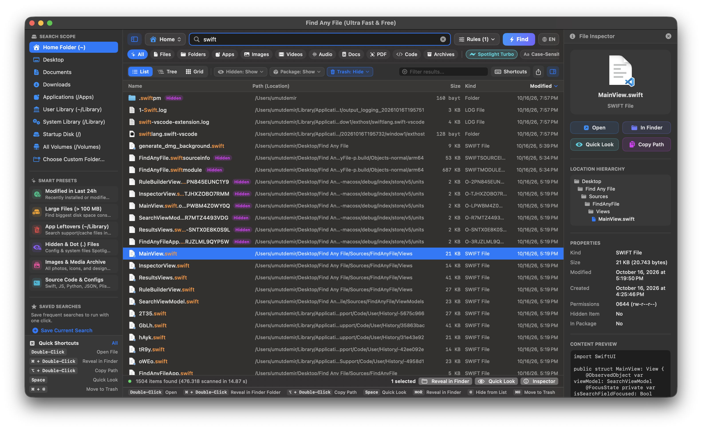
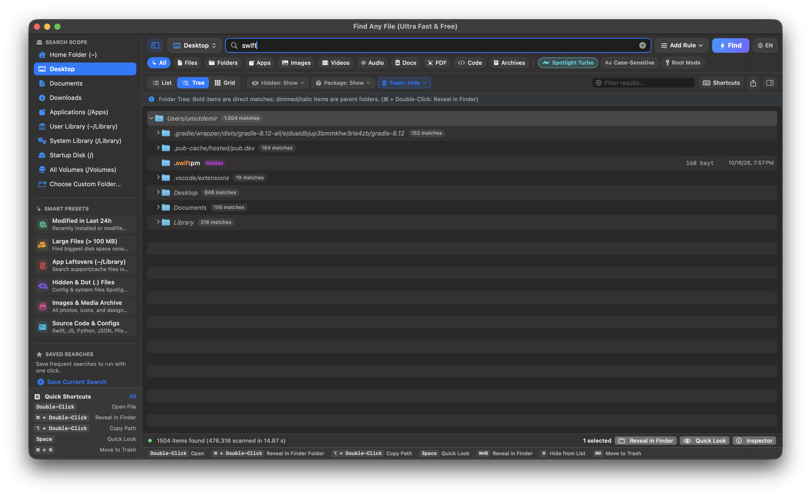
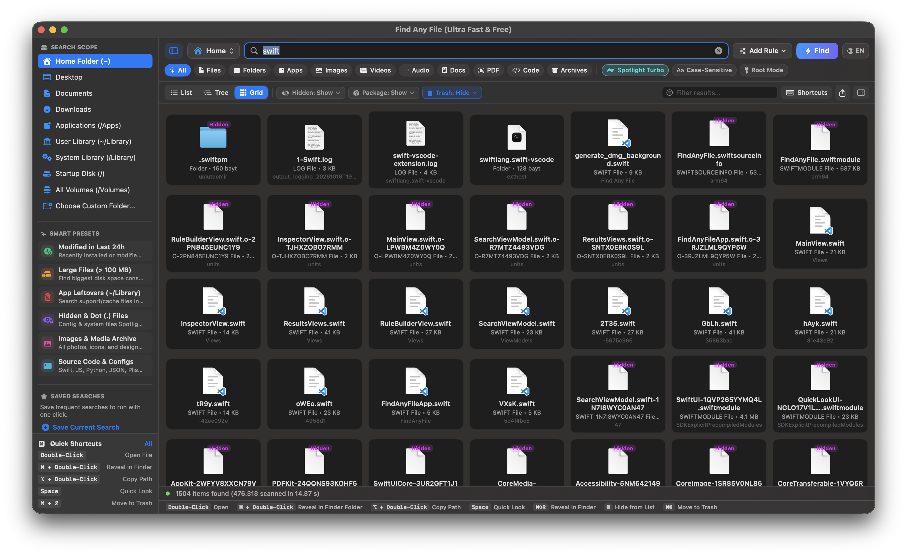
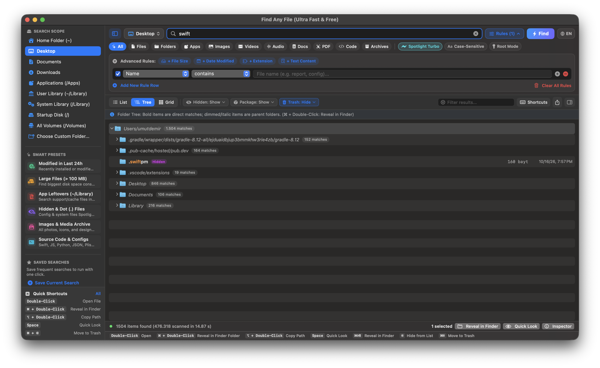

# Find Any File (macOS)

<p align="center">
  
</p>

<p align="center">
  <b>A completely free, ultra-fast, modern native macOS file search tool built with Swift & SwiftUI.</b><br>
  <i>Powered by a multi-core low-level POSIX <code>fts</code> engine and hybrid Spotlight turbo acceleration.</i>
</p>

<p align="center">
  <a href="https://github.com/umutdemir39/find-any-file/releases/latest"></a>
  
  
  
  
  
</p>

<p align="center">
  
</p>

---

## 📥 Download & Installation (macOS)

Download the prebuilt application directly from GitHub Releases:

| Package Type | Architecture | Direct Download Link |
| :--- | :--- | :--- |
| 💿 **DMG Installer** *(Recommended)* | Apple Silicon (M1/M2/M3/M4) | [**⬇️ Download Find-Any-File-macOS-arm64.dmg**](https://github.com/umutdemir39/find-any-file/releases/latest/download/Find-Any-File-macOS-arm64.dmg) |
| 📦 **ZIP Archive** *(Portable `.app`)* | Apple Silicon (M1/M2/M3/M4) | [**⬇️ Download Find-Any-File-macOS-arm64.zip**](https://github.com/umutdemir39/find-any-file/releases/latest/download/Find-Any-File-macOS-arm64.zip) |
| 🏷️ **All Releases** | macOS 14.0 Sonoma or later | [**🔗 View GitHub Releases**](https://github.com/umutdemir39/find-any-file/releases) |

### Installation Steps
1. Download **`Find-Any-File-macOS-arm64.dmg`** or **`Find-Any-File-macOS-arm64.zip`** from the links above.
2. **If using DMG:** Double-click the `.dmg` file and drag **`Find Any File.app`** into the **`Applications`** folder.
3. **If using ZIP:** Extract the archive and move **`Find Any File.app`** to `Applications` (or run it from anywhere).

> 💡 **macOS Gatekeeper Note (First Launch):**
> Because this open-source app is signed with an ad-hoc local signature rather than a paid Apple Developer ID certificate, macOS may show an *"unverified developer"* prompt on first launch:
> * **Right-click (or Control-click)** on `Find Any File.app` and select **Open**, **OR**
> * Run the following command once in Terminal:
>   ```bash
>   xattr -cr "/Applications/Find Any File.app"
>   ```

---

## ⚡ Why Find Any File?

macOS Spotlight is great for launching apps, but it often falls short when you are searching for system files, caches in `~/Library`, items hidden inside `.app` bundles, dot (`.`) files, or when Spotlight indexing is disabled or incomplete on external volumes and network shares.

**Find Any File** bridges this gap by combining:
1. **Multi-Core POSIX Engine**: Uses C-level `fts_open` / `fts_read` distributed across all Apple Silicon performance cores (`withTaskGroup`) to traverse the real file system directly at disk speed.
2. **Spotlight Turbo Hybrid**: Instantly pulls immediate index matches in milliseconds while the background engine concurrently inspects hidden directories, packages, and unindexed paths that Spotlight omits.
3. **Root Search (`Find as Root`)**: Option to search restricted directories and other user homes with elevated administrator privileges.
4. **Hierarchical Tree View**: Browse thousands of results organized by their parent folders with match counters, bold highlight for direct hits, and dimmed parent folders.
5. **Modern Bilingual UI**: English and Turkish supported out-of-the-box (English default).

---

## 📸 Screenshots

### 1. Flat List View & Live File Inspector (`⌘1` / `⌘⌥I`)
*Instant POSIX search results with syntax-highlighted search terms, collapsible Inspector showing hierarchy, exact permissions, and live code preview.*

<p align="center">
  
</p>

### 2. Hierarchical Folder Tree View (`⌘2`)
*Browse search results grouped by parent directories with live match count badges and expandable subtrees.*

<p align="center">
  
</p>

### 3. Responsive Thumbnail Grid View (`⌘3`)
*Visual grid presentation featuring high-resolution system icons, item sizes, and visibility status tags.*

<p align="center">
  
</p>

### 4. Advanced Multi-Rule Builder
*Combine granular search rules (AND logic) by Name, Extension, File Size, Date Modified, and Text Content.*

<p align="center">
  
</p>

---

## ✨ Features

- **Blazing Fast Concurrent Traversal**: Sharded directory scanning powered by Swift concurrency and Darwin POSIX APIs.
- **Three Signature Result Views**:
  - **Flat List View (`⌘1`)**: Sortable columns (Name, Path, Size, Kind, Date Modified), colored search term highlights, and status badges (`Hidden`, `Package`, `Link`).
  - **Hierarchical Tree View (`⌘2`)**: Displays results inside nested folder trees with match counts; direct hits are bold while parent folders are dimmed.
  - **Preview Grid View (`⌘3`)**: Responsive thumbnail cards with high-resolution system icons.
- **Instant Search & Multi-Rule Builder**:
  - Type instantly in the search bar or build complex criteria (AND logic).
  - Search by Name, Name without Extension, File Extension, Full Path, File Size (`>`, `<`, Bytes/KB/MB/GB), Date Modified/Created (relative time or exact dates), and Text Content.
  - Full Regular Expression (Regex) and Case-Sensitive matching support.
- **Three-State Visibility Filters**:
  - **Hidden Files (Invisibles)**: Show / Hide / Show Only.
  - **Package Contents (`.app`, `.bundle`)**: Show / Hide / Show Only.
  - **Trash Items (`.Trash`)**: Show / Hide / Show Only.
- **Collapsible File Inspector**:
  - Real-time file preview, interactive path breadcrumbs, POSIX octal and symbolic permissions (`0755 rwxr-xr-x`), byte sizes, and quick actions.
- **Smart Built-in Presets & Saved Searches**:
  - One-click presets for *Modified in Last 24h*, *Large Files (> 100 MB)*, *App Leftovers (~/Library)*, *Hidden & Dot Files*, *Media Archive*, and *Source Code*.
  - Save custom search configurations and reload them anytime.

---

## ⌨️ Mouse & Keyboard Shortcuts

| Shortcut / Gesture | Action |
| :--- | :--- |
| **`Left Double-Click`** | Opens the file or folder directly in default application |
| **`⌘ Command + Double-Click`** | **Reveals in Finder** and selects the item inside its enclosing folder |
| **`⌥ Option + Double-Click`** | Copies the full file path to the clipboard |
| **`⌘ Command + Single-Click`** | Multi-selection toggle for batch actions |
| **`Spacebar`** | Launches native macOS **Quick Look** preview |
| **`⌘ + ⇧ + R`** | Reveal selected items in Finder |
| **`⌘ + ⌥ + C`** | Copy full paths of all selected items |
| **`⌫ (Delete)`** | Hide selected items from results (does not delete from disk) |
| **`⌘ + ⌫`** | Move selected items to macOS Trash |
| **`⌘1` / `⌘2` / `⌘3`** | Switch between List, Folder Tree, and Grid views |
| **`⌘0`** | Toggle Left Sidebar |
| **`⌘⌥I`** | Toggle Right File Inspector |
| **`⌘/`** | Open Shortcuts Guide modal |

---

## 🛠️ Building from Source

Requirements: **macOS 14.0+** and **Xcode 15+ / Command Line Tools** (`swiftc`).

```bash
# 1. Clone the repository
git clone https://github.com/umutdemir39/find-any-file.git
cd find-any-file

# 2. Build the portable .app bundle
chmod +x build_app.sh
./build_app.sh
open "Find Any File.app"

# 3. (Optional) Build the styled DMG installer
chmod +x create_dmg.sh
./create_dmg.sh
```

---

## 🌐 Localization

Find Any File is fully bilingual:
- **English** (Default)
- **Türkçe** (Turkish)

Switch between English and Turkish at any time using the `🌐 EN / TR` button in the top search bar or via the `View` menu.

---

## 📄 License

This project is licensed under the MIT License - see the [LICENSE](LICENSE) file for details.
